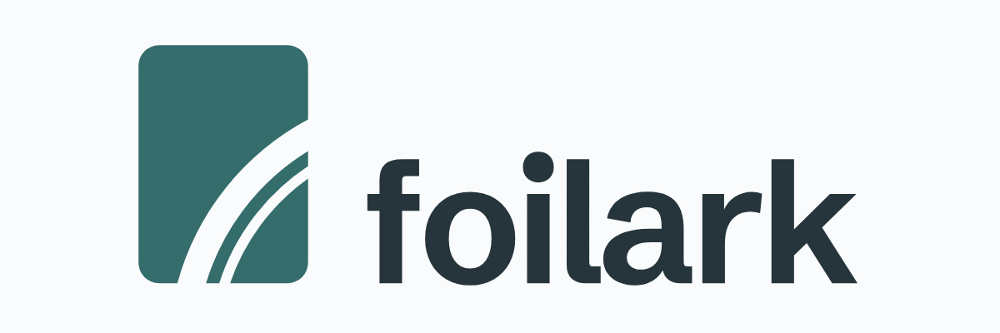

# Foilark logo



**Idea:** Foilark is *foil + ark*, the place that keeps your foil cards. The mark is a trading card crossed by one
curved foil reflection: a card, the light on its foil, nothing else. No Poké Ball, no card back (ADR 0009, ADR 0014).

Chosen on 2026-11-19 from three directions (`concepts/`: card ark, foil sweep, card arc).

## Files

All files are generated by [`build_logo.py`](build_logo.py); change the geometry there, never by hand.

```sh
uv run --with fonttools python design/logo/build_logo.py
```

| File | Use |
|---|---|
| `foilark-horizontal.svg` (`-black`, `-white`, `-night`) | Primary logo: mark + wordmark |
| `foilark-stacked.svg` | Square-ish spaces (splash, social avatar with text) |
| `foilark-symbol.svg` (`-black`, `-white`, `-night`) | The mark alone, 32 px and up |
| `foilark-symbol-small.svg` | Small-size cut (one band) for 16–24 px: favicon, notification, themed icon |
| `foilark-wordmark.svg` | Wordmark alone, where the mark is already shown |
| `foilark-app-icon.svg`, `foilark-app-icon-512.png` | Play Store icon (square; Google applies the mask) |
| `foilark-app-icon-rounded.svg` | Previews and the README (`assets/icon.svg`) |
| `web/` | favicon.ico/svg, PNG icons, webmanifest and `<head>` snippet for a product site |

The script also writes the Android drawables: `ic_launcher_foreground`, `ic_launcher_monochrome` (themed icons),
`ic_notification` and `ic_foilark_mark` (next to the in-app wordmark).

## Construction

- Card 148 × 208 on a 256 grid (the 63 : 88 card ratio), corner radius 18, centred 2 units above the middle.
- The sweep: concentric circles around a point outside the lower right corner. Wide band 24, gap 11, thin band 9.
  Every band runs from the straight bottom edge to the straight right edge, never through a corner.
- The small cut keeps one band, 28 wide, so it stays open at 16 px.
- Wordmark: lower-case "foilark" in Schibsted Grotesk 650, tracked −0.04 em, as `WordmarkStyle` in the app.
  Outlined as paths (the font is OFL, which allows this). In the horizontal lockup the cap height is half the card
  height and the baseline sits on the card's bottom edge.

## Colour

| Role | HEX | RGB |
|---|---|---|
| Sea-glass (mark) | `#356C6C` | 53 108 108 |
| Ink (wordmark) | `#26353C` | 38 53 60 |
| Porcelain (card on the icon) | `#FAFBFC` | 250 251 252 |
| Night sea-glass (mark on dark) | `#8CCBC2` | 140 203 194 |

Approved pairs: sea-glass + ink on porcelain or white · night version on the Pearl night surfaces · white on
sea-glass · black or white one-colour. Flat colour only: no gradients, shine or shadows on the mark (the foil is
the cut, not an effect).

## Clear space and minimum size

- Clear space on every side: the width of the wide band at the card's bottom edge (about 1/6 of the card width).
- Minimum size: symbol 32 px (below that use `foilark-symbol-small.svg`, down to 16 px); horizontal lockup 96 px
  wide on screen, 25 mm in print.

## Don't

Stretch, rotate or mirror the card · move or add bands · recolour outside the table · put the mark on card art or
busy photos without a calm surface · retype the wordmark in a live font · add a Poké Ball or card-back pattern.

## Open items

- Trademark: the name was screened (`docs/release/play-launch.md`); the mark itself has not been checked. Do a
  reverse image search before the store launch.
- Feature graphic (1024 × 500) for Play is not made yet.
